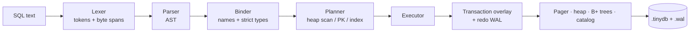

<div align="center">

# TINYSQL

**A relational database, written from scratch in Rust, that shows its work.**

Custom SQL parser · 4 KB slotted pages · B+ tree indexes · redo write-ahead log · local SQL Studio

[](https://github.com/Sendiw14/TinySQL/actions/workflows/ci.yml)


</div>

> [!WARNING]
> **Pre-release. The engine does not run SQL yet.** The project is in milestone **M0**: every format, protocol and API is being specified and test-fixtured *before* any engine code is written. Not crash-safe. Not for real data.

---

## Why TINYSQL

Most people use databases without ever seeing inside one. TINYSQL is small enough to read end to end and honest enough to trust as a learning tool:

- **Every byte is specified.** Page layouts, B+ tree nodes and WAL frames are defined at byte level, with golden binary files that the code must reproduce exactly.
- **Every claim needs evidence.** A feature is only marked `PASS` when a reproducible test proves it. The status table below is generated from that rule, not from optimism.
- **Failure is designed, not discovered.** 39 crash and error points are mapped *before* the write-ahead log exists, each with the exact outcome a user should see.
- **No borrowed engine.** Parsing, planning, storage, indexing and transactions are all original code. No SQLite, no ORM.

## The anatomy of a query



The same engine library serves both front doors:

| Interface | What it is | Where it runs |
|---|---|---|
| `tinysql` CLI | interactive shell with transactions | your terminal |
| `tinysql serve` | authenticated JSON API, loopback only (`127.0.0.1`) | your machine |
| Studio | Next.js workbench: editor, results, `EXPLAIN` plans, schema | your browser, talking to your local server |
| Website | static docs and architecture explainers | public, never touches a database |

## What v0.3 will support

```sql
CREATE TABLE students (
  id INTEGER PRIMARY KEY,
  name TEXT NOT NULL,
  gpa REAL,
  active BOOLEAN NOT NULL,
  year INTEGER
);
CREATE INDEX idx_students_year ON students (year);

INSERT INTO students (id, name, gpa, active, year) VALUES (1, 'Alex', 3.85, TRUE, 2026);

SELECT id, name FROM students WHERE gpa >= 3.50 ORDER BY id ASC LIMIT 50;
SELECT COUNT(*) FROM students WHERE active = TRUE;

BEGIN;
UPDATE students SET gpa = 3.90 WHERE id = 1;
ROLLBACK;

EXPLAIN SELECT * FROM students WHERE id = 1;   -- PK LOOKUP students.id = 1
```

| Included | Deliberately excluded |
|---|---|
| `INTEGER` (i64), `REAL`, `TEXT`, `BOOLEAN`, `NULL` with three-valued logic | `JOIN`, `GROUP BY`, aggregates beyond `COUNT(*)` |
| One `INTEGER PRIMARY KEY` per table, B+ tree indexed | `ALTER` / `DROP TABLE`, foreign keys, triggers |
| One optional secondary `INTEGER` index per table | concurrent writers, MVCC |
| `WHERE` with `AND` / `OR` / `NOT`, `ORDER BY`, `LIMIT` | `OFFSET` / pagination, cloud hosting |
| Explicit transactions with rollback, redo WAL, crash recovery | network SQL protocol, accounts |
| `EXPLAIN` showing the plan the executor actually runs | an optimizer cost model |

Full grammar and rules: [ADR-02](docs/decisions/ADR-02-sql-tokens-and-semantics.md).

## Status

| Milestone | Scope | State |
|---|---|---|
| **M0** | specifications, ADRs, golden fixtures, CI | 🔵 in progress: all drafts written, awaiting review |
| M1 | lexer, parser, binder | ⚪ blocked on M0 approval |
| M2 | in-memory execution | ⚪ |
| M3 | on-disk pages and catalog | ⚪ |
| M4 | B+ tree indexes and `EXPLAIN` | ⚪ |
| M5 | transactions, WAL, crash recovery | ⚪ |
| M6 | CLI and benchmarks | ⚪ |
| M7 | local API, Studio, public site | ⚪ |
| M8 | release | ⚪ |

Requirements: **1 of 56** required items passes today (CI green on a clean checkout). Live numbers: `python3 scripts/release-gate.py --report`.

## What exists today

| Artifact | Where |
|---|---|
| 12 architecture decision records | [`docs/decisions/`](docs/decisions/) |
| SQL golden tests: 39 lexer, 44 parser, 7 limit, 7 semantic scripts | [`crates/tinysql-engine/tests/fixtures/sql/`](crates/tinysql-engine/tests/fixtures/sql/) |
| Byte-exact page, B+ node and WAL samples | [`crates/tinysql-engine/tests/fixtures/format/`](crates/tinysql-engine/tests/fixtures/format/) |
| Crash and failure matrix (39 points) | [`docs/wal-failpoint-matrix.csv`](docs/wal-failpoint-matrix.csv) |
| Local API spec, OpenAPI 3.1 + 32 examples | [`docs/api/`](docs/api/) |
| Threat model | [`docs/security.md`](docs/security.md) |
| Design system, wireframes for all 18 routes, motion plan | [`docs/design/`](docs/design/) |
| Requirements matrix | [`docs/requirements-matrix.csv`](docs/requirements-matrix.csv) |
| Rust workspace skeleton | [`crates/`](crates/) |

## Run the checks

Requires Rust (the pinned 1.100.0 installs automatically through `rustup`), Python 3 with `PyYAML` and `jsonschema`, and Node.js.

```bash
git clone https://github.com/Sendiw14/TinySQL.git
cd TinySQL
cargo test --workspace --all-targets
python3 scripts/fixtures/run.py check
python3 scripts/check-api-fixtures.py
```

Every check and what it proves: [`docs/testing.md`](docs/testing.md).

## Repository layout

```text
crates/
  tinysql-engine/     the only home of SQL behavior
  tinysql-cli/        thin terminal adapter
  tinysql-server/     thin loopback HTTP adapter
docs/
  decisions/          ADR-01 … ADR-12
  api/                openapi.yaml + golden JSON examples
  design/             tokens, wireframes, motion
  implementation/     canonical specification
scripts/              fixture generators and project checks
```

`apps/site` and `apps/studio` arrive in M7.

## Principles

1. **Correctness before features.** A milestone ships only when its tests pass; website polish is cut before durability work is.
2. **Honest limits.** Unsupported SQL fails with a clear error and a suggestion, never a silent guess.
3. **Uncertain is not rolled back.** If a commit's outcome can't be known, TINYSQL says so and stops writing.
4. **Local by default.** The API binds to `127.0.0.1` only and requires a token; the public website never talks to it.

## Contributing

The project is in design review. Read the [specification](docs/implementation/master-prompt.md) and the [ADRs](docs/decisions/) first; open an issue to discuss a change before sending code.

## License

[MIT](LICENSE)
